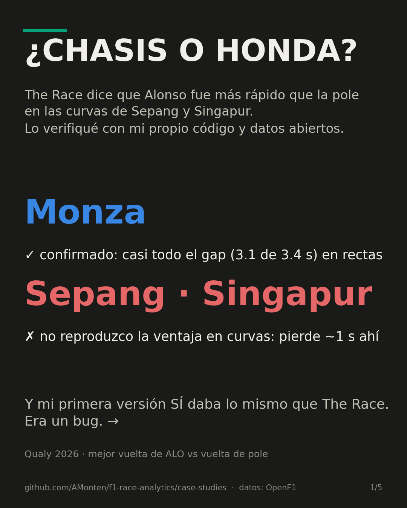
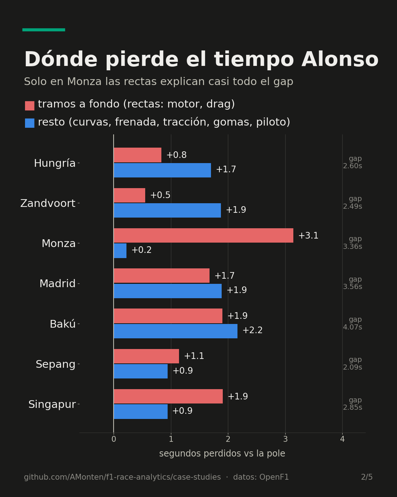
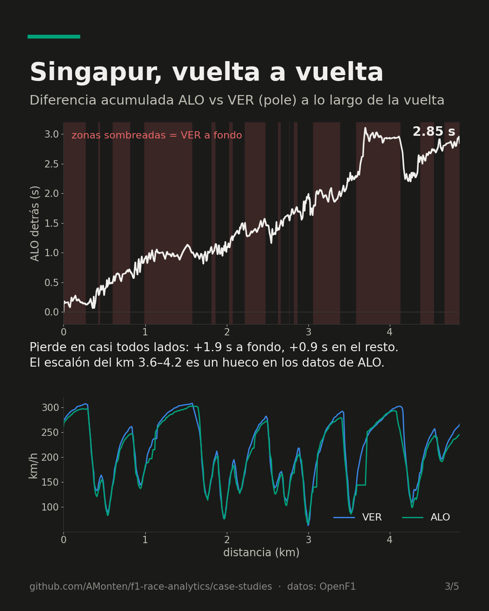
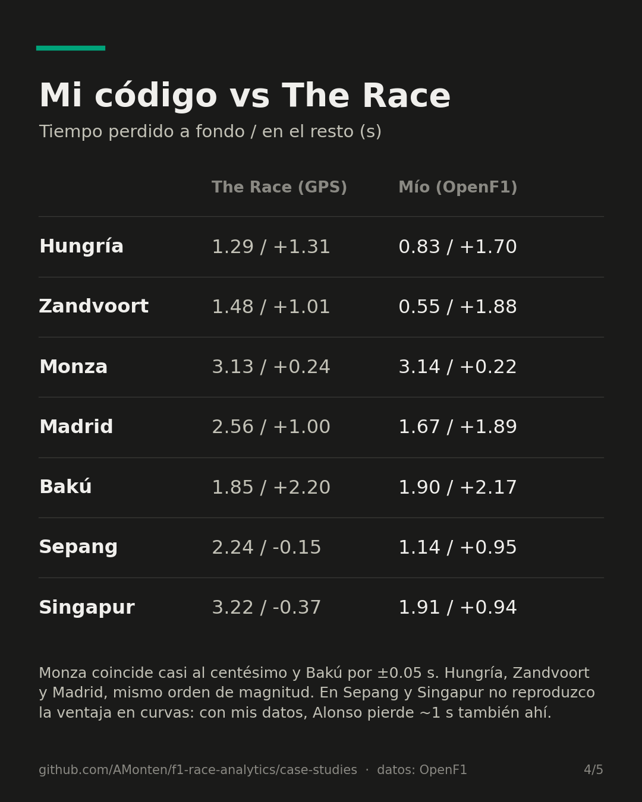
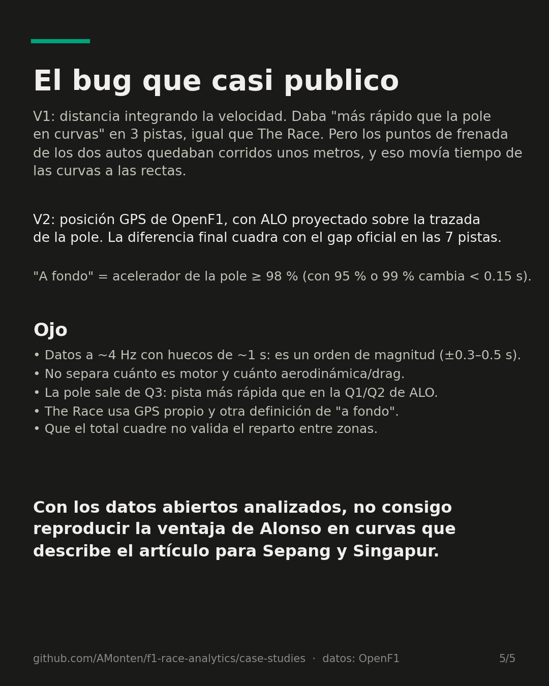

# Case study — Alonso, Honda and the full-throttle gap (2026 qualifying)

> **Question.** The Race ([Mark Hughes, 2026-10-16](https://www.the-race.com/formula-1/aston-martin-f1-pole-potential-extraordinary-figures/))
> split Fernando Alonso's qualifying gap to pole into time lost on
> full-throttle sections vs. everywhere else, and concluded that at Sepang and
> Singapore he was *faster than the pole car* away from the straights. Can
> that be reproduced with open data?

**Short answer:** partly. Monza reproduces almost to the hundredth and Baku within ~0.05 s.
At Sepang and Singapore, I can't reproduce the cornering advantage: with
open data, Alonso also loses roughly 1 s away from the straights.

*Versión corta en español: con los datos abiertos analizados, no consigo
reproducir la ventaja de Alonso en curvas que describe el artículo para
Sepang y Singapur. Monza sí se confirma.*

## Results

Seconds lost to the pole lap. "Full throttle" means the pole car is at
≥ 98 % throttle at that point on track; "rest" is everything else.

| Track | Pole | Gap | The Race: full throttle / rest | This analysis: full throttle / rest |
|---|---|---|---|---|
| Hungaroring | NOR | 2.601 | 1.29 / +1.31 | 0.83 / +1.70 |
| Zandvoort | NOR | 2.487 | 1.48 / +1.01 | 0.55 / +1.88 |
| Monza | GAS | 3.364 | 3.13 / +0.24 | **3.14 / +0.22** |
| Madrid | NOR | 3.564 | 2.56 / +1.00 | 1.67 / +1.89 |
| Baku | RUS | 4.067 | 1.85 / +2.20 | **1.90 / +2.17** |
| Sepang | VER | 2.090 | 2.24 / −0.15 | 1.14 / +0.95 |
| Singapore | VER | 2.850 | 3.22 / −0.37 | 1.91 / +0.94 |

Full output: [`results.csv`](results.csv) (method v2), and
[`results_v1_speed.csv`](results_v1_speed.csv) (the flawed v1 method, kept
for comparison).

## Method

1. **Data:** [OpenF1](https://openf1.org) `laps`, `car_data` (speed,
   throttle, ~4 Hz) and `location` (x/y). FastF1 is the project's normal
   source, but it returned no car telemetry for 2026 Singapore qualifying.
2. **Laps:** Alonso's best qualifying lap vs. the pole lap. These may come
   from different segments (Q1/Q2 vs. Q3).
3. **Alignment (v2):** the pole car's x/y path defines lap distance.
   Alonso's x/y samples are projected onto that path. This gives elapsed time
   for each car at the same point on track, on a 0.2 m grid.
4. **Split:** the cumulative time delta's increments are summed separately
   over the full-throttle points and the remaining points.

### The bug that changed the result (v1)

The first version derived lap distance by **integrating each car's speed
trace** (`python analysis.py --method speed`). It agreed with The Race:
"faster than pole in the corners" at Monza, Sepang and Singapore. The
cumulative delta trace gave it away. It had a sawtooth shape, with ~1 s
swings over a few metres at every braking zone. Small integration errors put
the two cars' braking points metres apart, which moved time from the corners
onto the straights. Using GPS position (v2) removed the sawtooth and changed
the conclusion at Sepang and Singapore.

## Limitations

- **Order of magnitude, not exact figures.** The data is ~4 Hz with gaps
  of up to ~1.2 s per lap, and GPS jitter is ±0.1 s locally. These errors
  accumulate at every boundary between zones, so assume roughly ±0.3–0.5 s
  on each split.
- **A matching total doesn't validate the split.** The computed total gap
  matches the official lap-time gap at every track, which is a useful check.
  It says nothing about whether each tenth is attributed to the right zone.
- **"Rest of lap" ≠ chassis.** It also includes braking, traction, tyres,
  driveability, energy deployment and the driver. "Full throttle" mixes
  power unit output with drag and wing level.
- **Track evolution.** Pole comes from Q3, which runs on a faster track
  than Alonso's Q1/Q2.
- **Different definitions.** The Race uses its own GPS data and does not
  publish its full-throttle threshold. Curiously, the flawed v1 method
  reproduces The Race's Hungaroring split almost exactly (1.287 / 1.314).
  That may be coincidence, or a sign their method shares some of v1's
  sensitivity. I can't tell which from the outside.
- **Threshold sensitivity is small.** Moving the threshold between 95 % and
  99 % changes the split by < 0.15 s (see the `full_throttle_loss_95_s` and
  `full_throttle_loss_99_s` columns).

## Reproduce

```bash
# from the repo root, with the project venv active
pip install matplotlib            # only needed for slides.py
cd case-studies/2026-alonso-full-throttle
python analysis.py                # GPS method → results.csv
python analysis.py --method speed # v1 method → results_v1_speed.csv
python slides.py                  # Instagram carousel → slides/
```

API responses are cached under `data/openf1_cache/` (gitignored). A cold run
takes a few minutes because of OpenF1's rate limit.

## Slides

| | | |
|---|---|---|
|  |  |  |
|  |  | |
